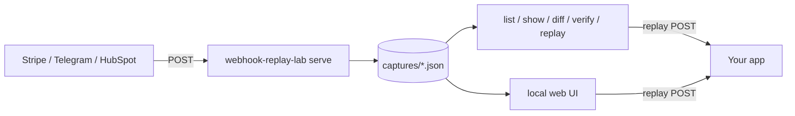

# webhook-replay-lab

Local lab for webhook work. It records incoming HTTP requests to JSON files, then lets you list, inspect, diff, verify, and replay them. A single-page UI is served by the same process when you pass `--ui`.

There is no account, no cloud, and no auth. Bind it to loopback and keep the capture directory private: bodies and headers often contain customer data and signatures.



```
┌ webhook-replay-lab ──────── local capture bench ─────────┐
│ POST /hooks/shop   fix_order_b   2024-06-02   98 b       │
│ POST /hooks/shop   fix_order_a   2024-06-01   86 b       │
│                                                           │
│ payload                                    [Copy curl]   │
│ { "order": "o_100", "status": "paid", "amount": 2500 }  │
│ Replay to [ http://127.0.0.1:9999/hook ]  [Replay]      │
└───────────────────────────────────────────────────────────┘
```

## Install

Requires Node.js 20 or newer.

```bash
npm install
npm test
npm run build
```

The `webhook-replay-lab` bin points at `dist/cli.js` (compiled with `tsc`). Use it directly, via `npm link`, or later with `npx webhook-replay-lab`.

```bash
node dist/cli.js --help
```

## Quick start

Terminal 1:

```bash
node dist/cli.js serve --port 8787 --dir ./captures --ui
```

Open <http://127.0.0.1:8787/>. Terminal 2:

```bash
curl -sS -X POST http://127.0.0.1:8787/hooks/stripe \
  -H 'content-type: application/json' \
  -d '{"id":"evt_manual","type":"charge.succeeded"}'

node dist/cli.js list --dir ./captures
node dist/cli.js show <id> --dir ./captures
node dist/cli.js replay <id> --to http://127.0.0.1:9999/hook --dir ./captures
node dist/cli.js diff <idA> <idB> --dir ./captures
```

Sample captures live in `fixtures/`. They verify offline with the fixture secret `whsec_test_fixture_only`. That value is not a real signing secret. It only matches the files in this repository.

```bash
node dist/cli.js verify fix_stripe_valid \
  --provider stripe \
  --secret whsec_test_fixture_only \
  --now 1700000100 \
  --dir ./fixtures

node dist/cli.js verify fix_hmac_valid \
  --provider hmac \
  --secret whsec_test_fixture_only \
  --dir ./fixtures
```

## CLI

| Command | Purpose |
| --- | --- |
| `serve` | Record webhooks. `--port` (8787), `--host` (127.0.0.1), `--dir`, `--ui`, `--max-body` (1048576). |
| `list` | Newest captures first. `--json` prints the raw array. |
| `show <id>` | Pretty-print one capture. |
| `replay <id> --to <url>` | Send the original body to a URL. `--preserve-headers`, `--timeout`. Exit 1 when the target is not 2xx. |
| `diff <idA> <idB>` | Compare payloads. Exit 0 when the diff is printed. `equal: true/false` is in the output. |
| `verify <id> --provider stripe\|hmac` | Check a signature. Exit 0 when valid, 1 when not. |

Every command accepts `--dir` (default `./captures`). `list`, `diff`, `verify`, and `replay` accept `--json`.

`serve` answers:

- `GET /` — HTML UI when `--ui` is set, otherwise a plain-text status
- `GET /health` — `{ "ok": true, "service": "webhook-replay-lab", "version": "..." }`
- `GET /api/captures` and `GET /api/captures/:id`
- `GET /api/captures/:id/curl` — shell command. Optional `?to=` replaces the URL
- `POST /api/captures/:id/replay` — JSON body `{ "to", "preserveHeaders", "timeoutMs" }`
- anything else — stored as a capture, response `{ "ok": true, "id" }`

`GET /favicon.ico` is ignored. Paths under `/api/` are never stored.

## Capture format

Each event is `<dir>/<id>.json`:

```json
{
  "id": "whr_m1abc_a1b2c3d4",
  "timestamp": "2026-11-02T12:00:00.000Z",
  "method": "POST",
  "path": "/hooks/stripe",
  "query": "",
  "headers": { "content-type": "application/json" },
  "rawBody": "{\"id\":\"evt_1\"}",
  "contentType": "application/json",
  "remoteAddr": "127.0.0.1"
}
```

`rawBody` is the exact UTF-8 body. Bytes that are not valid UTF-8 are stored as base64 and `bodyEncoding` is `"base64"`, so signature checks and replays still see the original bytes. Writes are atomic (temp file, then rename). Ids are restricted to `[A-Za-z0-9_-]`, so a capture id cannot escape the directory.

## Signature verification

Secrets are never hard-coded and never printed. Pass one of:

- `--secret <secret>` (visible in the process list; fine for the fixture secret)
- `--secret-file <path>` (a trailing newline is stripped)
- `STRIPE_WEBHOOK_SECRET` (preferred for `--provider stripe`)
- `WEBHOOK_SECRET` (preferred for `--provider hmac`)

A flag wins over a file, and a file wins over the environment.

### Stripe

Header: `Stripe-Signature: t=<unix>,v1=<hex>[,v1=<hex>...]`

The signed bytes are the UTF-8 of `<unix>.` concatenated with the raw body. The digest is HMAC-SHA256, hex-encoded. Every `v1` value is checked, so a rotated secret still matches. `v0` is ignored.

The age check matches Stripe's libraries. With the default `--tolerance 300`, a timestamp older than 300 seconds fails. `--tolerance 0` disables the age check. Timestamps in the future are accepted. `--now <unix-seconds>` pins the clock so fixtures verify without a network and without waiting on the wall clock.

The comparison uses the raw body. Re-serializing JSON before verify will fail, which is what Stripe does in production.

### HMAC

Header: `X-Hub-Signature-256: sha256=<hex>` (HubSpot, GitHub, and similar).

The digest is HMAC-SHA256 over the raw body. Override the header with `--header` and the prefix with `--prefix`. An empty prefix compares a raw hex digest.

Replay does **not** mint a new signature. Pass `--preserve-headers` to forward the captured signature headers. A fresh Stripe delivery will still fail the target's tolerance window if the original timestamp is old. Without `--preserve-headers`, replay sends `content-type`, `user-agent: webhook-replay-lab`, and `x-webhook-replay-id`, `x-webhook-replay-timestamp`, `x-webhook-replay-path`. Header names or values that contain control characters are dropped on the way out.

## Web UI

`serve --ui` serves the bench at `/`. It lists captures, shows headers and a pretty payload, copies a `curl` command, and replays to a URL you type. Live refresh is off until you check Live. The page is one HTML file with no external assets. Payload text is inserted with `textContent`.

The JSON API is available even when the UI is off, so scripts can drive a running lab. Anyone who can reach the port can read captures and trigger replays. The default host is `127.0.0.1`.

## Tests

`npm test` compiles with `tsc` and runs Vitest. The suite is offline: fixture signatures, in-memory HMAC checks, and a local mock target. No provider API and no real secret is required.

## Development

```
src/         CLI and library
tests/       Vitest
fixtures/    sample Stripe, HMAC, order, and Telegram captures
dist/        tsc output (gitignored)
```

```bash
npm install
npm test
npm run serve   # dist/cli.js serve --ui
```

## License

MIT. See [LICENSE](LICENSE).
